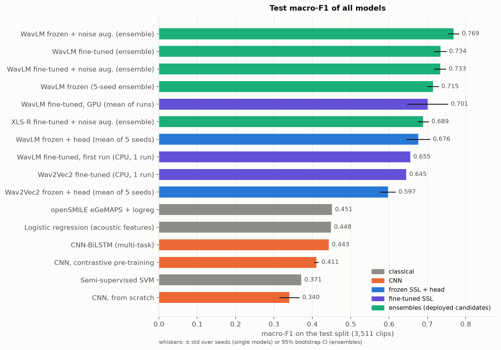
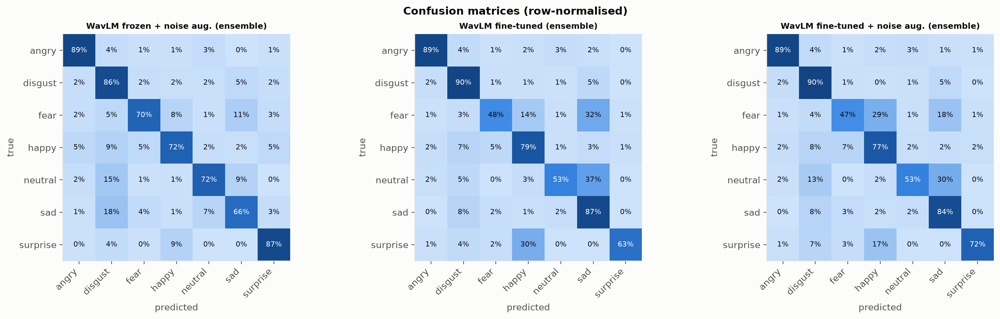
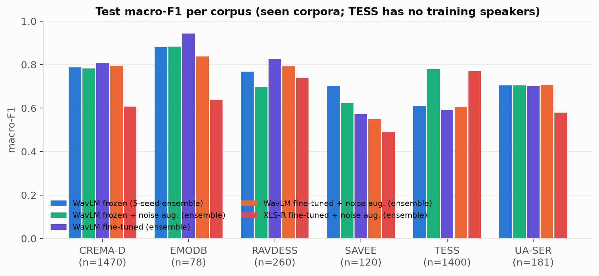
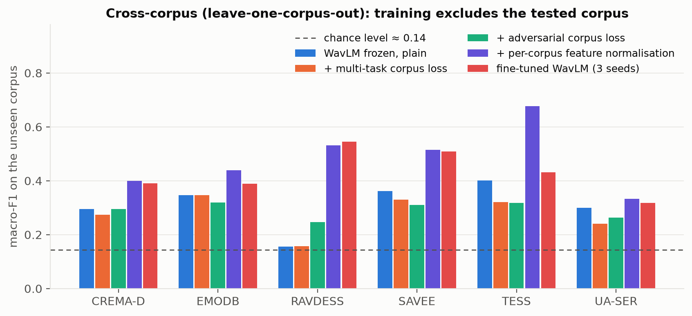
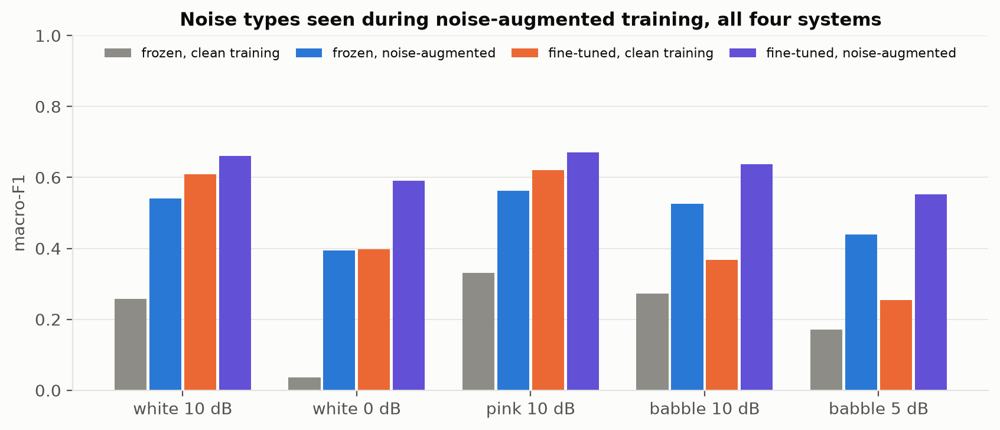
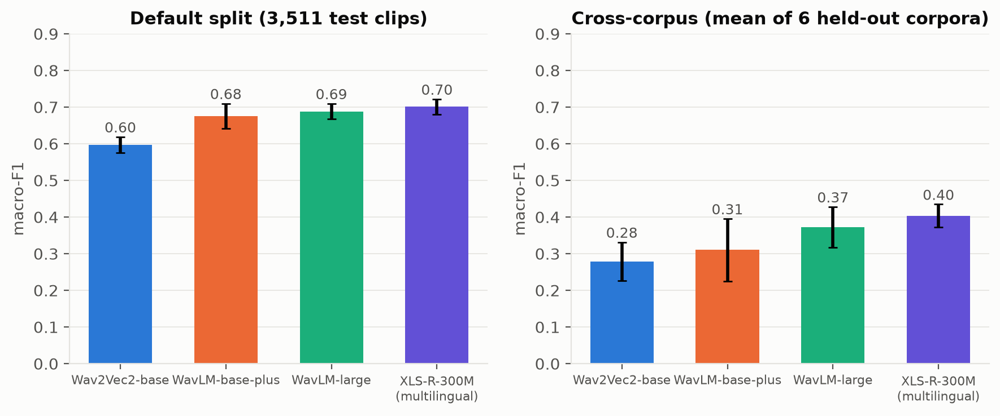

<div align="center">

# 🎙️ Speech Emotion Recognition

**7 emotions · 7 corpora · 4 languages · frozen WavLM + light head**


-EE4C2C?logo=pytorch&logoColor=white)


Diploma thesis code · Tetiana Mohorian · Košice, 2026

</div>

---

## 📌 About

The project classifies a speech recording into one of seven emotions:
**angry · disgust · fear · happy · neutral · sad · surprise**.

It answers one question: *how far can a pretrained speech model get when it is trained on acted emotional speech from several
languages, and how well does the result survive speakers, corpora and noise it has never seen?* To answer it, the repository compares

* classical models on hand-crafted features (MFCC, eGeMAPS): LR, SVM, Random Forest,
* neural networks trained from scratch: CNN and CNN-BiLSTM, with and without contrastive self-supervised pre-training,
* frozen self-supervised encoders (wav2vec 2.0, WavLM, WavLM-large, XLS-R) with a light classification head,
* fully fine-tuned WavLM and XLS-R,
* semi-supervised self-training, multi-task and adversarial corpus heads,
* leave-one-corpus-out transfer, a Slovak-only evaluation, and robustness to seen and unseen noise.

Everything uses **one** speaker-disjoint train / validation / test split, so the numbers are directly comparable.

---

## 🏆 Results at a glance

Test split: 3,511 clips from speakers that never appear in training. Metric: macro-F1 over 7 emotions.
Full tables: [`experiments/v2/FINAL_RESULTS.md`](experiments/v2/FINAL_RESULTS.md).

| Model | macro-F1 | accuracy |
|---|---:|---:|
| 🥇 **WavLM frozen + noise-augmented heads (5 seeds), deployed default** | **0.769** | 0.766 |
| Fine-tuned WavLM, ensemble of the "none" runs | 0.734 | 0.738 |
| Fine-tuned WavLM with noise augmentation, ensemble | 0.733 | 0.736 |
| WavLM frozen + head, ensemble of 5 seeds (clean training) | 0.715 | 0.709 |
| Fine-tuned XLS-R-300M, ensemble of 3 runs | 0.689 | n/a |
| Wav2Vec2 frozen + head, ensemble of 5 seeds | 0.608 | 0.629 |
| openSMILE eGeMAPS + logistic regression | 0.451 | 0.463 |
| CNN-BiLSTM (from scratch) | 0.443 | 0.476 |
| openSMILE eGeMAPS + SVM-RBF | 0.437 | 0.482 |
| openSMILE eGeMAPS + Random Forest | 0.404 | 0.435 |
| Semi-supervised SVM | 0.371 | 0.408 |
| CNN on log-mel (from scratch) | 0.297 | 0.312 |

The 95% bootstrap CI of the clean-training frozen ensemble is [0.700, 0.728].



### 🔑 Key findings

* **Pretrained speech models beat everything trained from scratch by a wide margin** (0.72 vs 0.30 to 0.45).
* **Fine-tuning gives a small gain over frozen features** (+0.020 macro-F1, 95% CI +0.004 to +0.036) but is expensive (about 23 min per
  run on a GPU) and unstable across seeds (0.635 to 0.763).
* **Noise-augmented heads are the best deployable model**: +0.057 on clean audio and +0.17 to +0.36 at white noise from 20 to 5 dB.
  Caveat: without TESS the clean-trained heads are slightly better (0.757 vs 0.735).
* **Generalisation across corpora is the real weakness**: leave-one-corpus-out macro-F1 is only about 0.31 for frozen WavLM
  (chance is about 0.14 to 0.17). Per-corpus feature normalisation lifts it to **0.483**, fine-tuning to 0.430.
* **Multilingual XLS-R transfers better than WavLM** across corpora (0.403 vs 0.310 frozen), WavLM-large in between (0.372).
* **Multi-task and adversarial corpus heads do not help significantly**: differences of 0.01 to 0.02 are smaller than the seed std.
* **Self-supervised pre-training of a small CNN helps most with few labels**: 0.096 to 0.208 with 10% of the labels.
* **Self-training gives no reliable gain** over supervised learning in this setting.
* **Uncertainty is usable**: answering only when confidence is at least 0.5 keeps 53.5% of clips at 90.4% accuracy (deployed model).

### 📊 Per-emotion result (deployed noise-augmented ensemble, clean test)

| emotion | precision | recall | F1 | support |
|---|---:|---:|---:|---:|
| angry | 0.883 | 0.889 | **0.886** | 569 |
| disgust | 0.606 | 0.858 | 0.710 | 508 |
| fear | 0.833 | 0.701 | 0.762 | 519 |
| happy | 0.819 | 0.718 | 0.765 | 574 |
| neutral | 0.813 | 0.720 | 0.764 | 521 |
| sad | 0.721 | 0.662 | 0.690 | 565 |
| surprise | 0.745 | 0.871 | 0.803 | 255 |



### 🌍 Per corpus (frozen WavLM, clean-trained ensemble)

| corpus | language | test clips | macro-F1 |
|---|:-:|---:|---:|
| EMO-DB | de | 78 | 0.880 |
| CREMA-D | en | 1,470 | 0.788 |
| RAVDESS | en | 260 | 0.767 |
| UA-SER | uk | 181 | 0.705 |
| SAVEE | en | 120 | 0.703 |
| TESS | en | 1,400 | 0.611 |

TESS has only two speakers and is never in training, so about 40% of the test set is unseen-speaker **and** unseen-corpus.
The honest summary numbers are therefore:

| view | macro-F1 |
|---|---:|
| full test (40% TESS) | 0.715 |
| test without TESS | 0.757 |
| mean of per-corpus macro-F1 | 0.742 |
| speaker-grouped 5-fold CV over all 13,406 clips | 0.733 (folds 0.743 ± 0.020) |



### 🔀 Cross-corpus transfer (leave-one-corpus-out, macro-F1 on the unseen corpus)

| held-out corpus | frozen WavLM | + per-corpus normalisation | fine-tuned WavLM |
|---|---:|---:|---:|
| CREMA-D | 0.295 | 0.400 | 0.391 |
| EMO-DB | 0.346 | 0.438 | 0.388 |
| RAVDESS | 0.156 | 0.531 | 0.545 |
| SAVEE | 0.362 | 0.515 | 0.509 |
| TESS | 0.401 | 0.677 | 0.431 |
| UA-SER | 0.300 | 0.334 | 0.318 |
| **average** | 0.310 | **0.483** | 0.430 |

Slovak (SVK-DB, only 30 clips and 4 speakers): macro-F1 0.231 zero-shot, CI [0.09, 0.35]. This is a rough indication only.



### 🔊 Noise robustness (macro-F1, 1,050-clip test subset)

| condition | clean-trained heads | noise-augmented heads | fine-tuned + noise |
|---|---:|---:|---:|
| clean | 0.717 | **0.774** | 0.713 |
| white noise 20 dB | 0.499 | 0.669 | **0.685** |
| white noise 10 dB | 0.257 | 0.540 | **0.661** |
| white noise 5 dB | 0.101 | 0.495 | **0.647** |
| babble 10 dB | 0.273 | 0.525 | **0.637** |
| reverberation 0.8 s *(not in training)* | 0.266 | 0.302 | **0.395** |
| telephone band *(not in training)* | 0.424 | 0.529 | **0.537** |
| clipping *(not in training)* | 0.705 | **0.768** | 0.712 |

Noise augmentation helps most for noise types seen in training; reverberation and telephone-band speech remain hard.



### 🧠 Backbone comparison (frozen features, same head)

| backbone | default split F1 | cross-corpus F1 |
|---|---:|---:|
| Wav2Vec2-base | 0.597 ± 0.021 | 0.279 |
| WavLM-base-plus | 0.676 ± 0.034 | 0.310 |
| WavLM-large | 0.688 ± 0.021 | 0.372 |
| XLS-R-300M (multilingual) | 0.701 ± 0.021 | 0.403 |



### ✅ Validity checks

* No speaker appears in two parts of the split (535 speakers: 361 train, 94 validation, 80 test).
* 10 exact-duplicate rows in the data, none crossing the splits; no test clip has a near-duplicate (cosine > 0.995) in training.
* Configurations are selected on validation only; the test split is scored once.

---

## 🗂️ What each file does

### 1 · Data

| File | What it does |
|---|---|
| [`prepare_combined_dataset.py`](prepare_combined_dataset.py) | Walks the seven corpus folders, converts every recording to 16 kHz mono PCM-16, unifies emotion names and writes `combined_dataset_normalized.csv`. |
| [`common_splits.py`](common_splits.py) | **Single source of truth for the split.** Builds the speaker-disjoint train / validation / test table (13,406 clips) and caches it to `experiments/v2/splits.csv`. Every other script imports `load_splits()` from here. |

### 2 · Features

| File | What it does |
|---|---|
| [`extract_ssl_embeddings.py`](extract_ssl_embeddings.py) | Runs a frozen pretrained model (WavLM, wav2vec 2.0, XLS-R) over all clips and stores mean/std-pooled embeddings of **every layer** in `experiments/v2/emb_<tag>.npz`. The slowest step (about 50 min per model on CPU). |
| [`opensmile_baseline.py`](opensmile_baseline.py) | Extracts eGeMAPS acoustic features with openSMILE and trains LR, SVM-RBF and Random Forest; hyper-parameters are picked on validation. |

### 3 · Models

| File | What it does |
|---|---|
| [`train_frozen_heads.py`](train_frozen_heads.py) | **The main model.** Light head on frozen embeddings: softmax-weighted sum over layers, LayerNorm, MLP. Supports an auxiliary corpus head (multi-task) and an adversarial one (gradient reversal), 5 seeds, and `--loco` leave-one-corpus-out. |
| [`train_wavlm_v2.py`](train_wavlm_v2.py) | Full fine-tuning of WavLM / wav2vec 2.0 / XLS-R: waveform augmentation, weighted layer sum, layer-wise learning-rate decay, warm-up + cosine schedule, label smoothing, bf16. GPU, about 23 min per run. |
| [`train_cnn_ssl_v2.py`](train_cnn_ssl_v2.py) | Controlled study with one CNN encoder: random init vs contrastive (NT-Xent) pre-training on unlabelled train audio, with 100% and 10% of the labels, plus a linear probe. |
| [`train_models.py`](train_models.py) | First-generation experiments: classical models on about 290 hand-crafted acoustic features, and the comparison runner. |
| [`train_deep_models.py`](train_deep_models.py) | First-generation neural models: CNN on log-mel, CNN-BiLSTM with attention, wav2vec 2.0 / WavLM multi-task fine-tuning. |
| [`semi_supervised_wavlm.py`](semi_supervised_wavlm.py) | Self-training with pseudo-labels on WavLM embeddings versus plain supervised learning, for several labelled fractions and seeds. |
| [`fair_baselines.py`](fair_baselines.py) | The same labelled-fraction comparison for a LinearSVC, with and without pseudo-labels. |

### 4 · Robustness to noise

| File | What it does |
|---|---|
| [`noise_utils.py`](noise_utils.py) | White, pink (1/f) and babble noise generators and mixing at a target SNR. |
| [`extract_noisy_embeddings.py`](extract_noisy_embeddings.py) | WavLM embeddings of noisy copies of the clips (random noise type, SNR 0 to 30 dB) for training, plus a fixed noisy test subset. |
| [`train_noise_robust.py`](train_noise_robust.py) | Trains heads on clean + noisy embeddings and saves them to `models/noise_robust/`: the **default model**. |
| [`robustness_noise.py`](robustness_noise.py) | Measures how the clean-trained model degrades with SNR. |
| [`evaluate_noise_all.py`](evaluate_noise_all.py) | Evaluates every system on *identical* corrupted audio, including corruptions never seen in training (reverberation, telephone band, brown noise, mains hum, clipping). |

### 5 · Validity checks and analysis

| File | What it does |
|---|---|
| [`extra_eval.py`](extra_eval.py) | `grouped_cv`: speaker-grouped 5-fold CV. `loco_norm`: leave-one-corpus-out with per-corpus normalisation. `duplicates`: exact and near-duplicate / leakage scan. |
| [`svk_loso.py`](svk_loso.py) | Slovak corpus evaluated on all 30 clips: zero-shot and leave-one-speaker-out, with bootstrap confidence intervals. |
| [`eval_backbones.py`](eval_backbones.py) | Compares wav2vec 2.0, WavLM-base, WavLM-large and XLS-R with the same head, on the default split and leave-one-corpus-out. |

### 6 · Reports and figures

| File | What it does |
|---|---|
| [`final_evaluation.py`](final_evaluation.py) | Collects every result into [`experiments/v2/FINAL_RESULTS.md`](experiments/v2/FINAL_RESULTS.md): model table, bootstrap CIs, per-corpus and per-emotion scores, calibration, noise, fine-tuning. |
| [`make_figures.py`](make_figures.py) | Draws all result figures in one consistent style into `experiments/v2/figures/` (17 PNGs). |
| [`make_thesis_figures.py`](make_thesis_figures.py) | Draws the data-preparation and architecture figures used in the thesis into `diplomka/obrazky/` (created on first run; needs `splits.csv` and the audio in `audio_16k_mono/`). |

### 7 · Deployable model

| File | What it does |
|---|---|
| [`export_model.py`](export_model.py) | Trains and saves the five deployable heads on frozen WavLM features (`--norm` for the per-source-normalised variant). |
| [`export_finetuned.py`](export_finetuned.py) | Copies the selected fine-tuned checkpoints into `models/finetuned/` (not in this repository, 1.5 GB). |
| [`predict_emotion.py`](predict_emotion.py) | Command-line inference: one file, a folder (`--csv`), an emotion timeline over 3 s windows, or the microphone. Refuses digital silence, warns when the speech share is low and can answer "uncertain" below a confidence threshold. |
| [`verify_demo.py`](verify_demo.py) | **Quick verification without any dataset**: runs the model on the 66 test clips in `samples/` and prints accuracy, per-emotion recall, per-corpus accuracy and the confusion matrix. `--standard` uses the clean-trained heads. |
| [`tests/test_pipeline.py`](tests/test_pipeline.py) | Sanity tests: the split is speaker-disjoint and the right size, labels and files exist, the predictor returns a valid distribution, a known clip is classified as angry, silence is refused and the timeline works. Needs the audio corpora. |

### 8 · Data and results that ship with the repository

| Path | Contents |
|---|---|
| [`models/noise_robust/`](models/noise_robust) | 5 trained heads (default model), about 8.5 MB |
| [`models/wavlm_head_seed*.pt`](models) | 5 heads trained on clean audio only (`--standard`) |
| [`models/norm/`](models/norm) | 5 heads for per-source feature normalisation |
| [`samples/`](samples) | 66 test-split clips (all corpora except SVK-DB) with labels in `labels.csv`, for `verify_demo.py` |
| [`experiments/v2/splits.csv`](experiments/v2/splits.csv) | the 13,406-clip split with speaker ids |
| [`experiments/v2/FINAL_RESULTS.md`](experiments/v2/FINAL_RESULTS.md) | every number reported above |
| [`experiments/v2/figures/`](experiments/v2/figures) | 17 result figures |

---

## 🧭 How the pieces fit together

```
corpora ──► prepare_combined_dataset ──► common_splits ──► splits.csv
                                                              │
                  ┌───────────────────────────────────────────┤
                  ▼                                           ▼
        extract_ssl_embeddings                      opensmile_baseline / train_models
                  │                                 train_deep_models / train_cnn_ssl_v2
                  ▼
        train_frozen_heads ──► extra_eval · svk_loso · eval_backbones
                  │
                  ├──► extract_noisy_embeddings ──► train_noise_robust ──► models/noise_robust
                  │                                                              │
                  └──► train_wavlm_v2 (GPU) ──► export_finetuned                 ▼
                                                                         predict_emotion

        everything ──► final_evaluation ──► FINAL_RESULTS.md ──► make_figures
```

---

## 📖 Where each part of the thesis comes from

Section numbers refer to the thesis text (chapter 4 describes the implementation, `FINAL_RESULTS.md` section numbers are in the last column).

| Thesis section | Topic | Scripts | `FINAL_RESULTS.md` |
|---|---|---|---|
| 4.2.4, 4.3 | Source code organisation, data preparation, split, leakage check | `prepare_combined_dataset.py`, `common_splits.py`, `extra_eval.py duplicates` | 9 |
| 4.4.1 – 4.4.3 | Metrics, variability over seeds, results on groups of data | `final_evaluation.py`, `extra_eval.py grouped_cv` | 1, 2, 3 |
| 4.4.4, 4.8.5 | Robustness to noise | `noise_utils.py`, `robustness_noise.py`, `extract_noisy_embeddings.py`, `train_noise_robust.py`, `evaluate_noise_all.py` | 7, 7b, 7g |
| 4.4.5, 4.8.6 | Calibration, rejection of uncertain predictions | `final_evaluation.py` | 5, 7b2 |
| 4.5 | MFCC / eGeMAPS features, classical models, self-training with few labels | `train_models.py`, `opensmile_baseline.py`, `fair_baselines.py` | 1, 8 |
| 4.6 | CNN and CNN-BiLSTM, contrastive pre-training | `train_deep_models.py`, `train_cnn_ssl_v2.py` | 1, 8 |
| 4.7.1 | Frozen wav2vec 2.0 / XLS-R / WavLM + head | `extract_ssl_embeddings.py`, `train_frozen_heads.py`, `eval_backbones.py` | 2, 7e |
| 4.7.2, 4.7.3 | Fine-tuning and comparison with frozen features | `train_wavlm_v2.py`, `export_finetuned.py` | 7c, 7d, 7d2 |
| 4.7.4 | Multi-task, adversarial, self-training, per-corpus normalisation | `train_frozen_heads.py`, `semi_supervised_wavlm.py`, `extra_eval.py loco_norm` | 2, 4, 8 |
| 4.8.1 – 4.8.3 | Model comparison, per-emotion results, confusion matrices | `final_evaluation.py`, `make_figures.py` | 1, 6 |
| 4.8.4 | Cross-corpus generalisation (LOCO), Slovak corpus | `train_frozen_heads.py --loco`, `svk_loso.py` | 4, 7f |
| 4.8.7 | Selection of the final model | `train_noise_robust.py`, `export_model.py` | 7b |
| 4.9.2 | Command-line application | `predict_emotion.py`, `verify_demo.py`, `tests/test_pipeline.py` | n/a |
| 4.9.3 – 4.9.6 | Web application, Telegram bot, shared database, app tests | **not in this repository** | n/a |

---

## 🚀 Quick start

```powershell
python -m venv .venv
.\.venv\Scripts\activate
pip install torch torchaudio --index-url https://download.pytorch.org/whl/cpu
pip install -r requirements.txt
```

Tested with Python 3.14.6 on Windows 11 (a fresh virtual environment from the commands above reproduces `verify_demo.py` exactly), CPU only (Intel Core i9-12900H, 31.7 GB RAM). Fine-tuning was run on a laptop RTX 3060
in a separate CUDA environment. The first run downloads `microsoft/wavlm-base-plus` from Hugging Face.

The trained heads are in the repository, so prediction works without any dataset:

```powershell
python predict_emotion.py clip.wav                     # one file
python predict_emotion.py folder --csv out.csv         # a folder -> CSV
python predict_emotion.py long.wav --timeline          # emotion per 3 s window
python predict_emotion.py --record 5                   # 5 s from the microphone
```

## ✔️ Verifying the model

**Without any dataset (1 minute).** The repository contains 66 recordings from the test split (speakers the model never saw):

```powershell
python verify_demo.py              # default model (noise-augmented heads)
python verify_demo.py --standard   # heads trained on clean audio only
```

On these clips the default model gets 51 / 66 correct (accuracy 0.773): angry 10/10, disgust 9/10, surprise 5/6, fear, happy and
neutral 7/10, sad 6/10. This is a rough sanity check, consistent with the full-test accuracy of 0.766 (3,511 clips); it is not a
replacement for the full evaluation. `samples/demo_predictions.csv` stores the per-clip predictions.

**On the full test set.** There is no shortcut: the numbers in `FINAL_RESULTS.md` come from the saved outputs of all experiments, so
reproducing them means downloading the audio (below) and running the table of steps 1 to 11.

## 🔁 Reproducing the experiments

The audio corpora are not included in the repository. Two ways to get them:

* **Ready-made normalised audio (16 kHz mono):** [download `audio_16k_mono` from Google Drive](https://drive.google.com/file/d/1K40_5OKjv6G-JoBJ3yKGtE31-Hx5hAwf/view?usp=sharing),
  unpack it into the project root as `audio_16k_mono/`, then **skip step 1** and start with step 3.
* **From the original corpora:** download them separately into `CREMA-D/`, `RAVDESS/`, `TESS/`, `SAVEE/`, `EMODB/`, `UA-SER/`
  and `SVK-DB/` in the project root and run step 1, which combines and normalises them.

Notes on the data:

* `UA-SER` and `SVK-DB` are not freely downloadable. If you reproduce from the original corpora, they have to be obtained from their
  authors; the supervisor receives them together with the archive, not through this repository. Without them the pipeline still runs,
  but the numbers for the Ukrainian and Slovak parts and the totals (13,406 clips) will differ.
* The archive contains the same 16 kHz mono recordings that `prepare_combined_dataset.py` produces.
* The recordings belong to their original authors and are subject to the licences of the individual corpora.

| Step | Command | Output |
|---|---|---|
| 1 | `python prepare_combined_dataset.py` | `audio_16k_mono/`, `combined_dataset_normalized.csv` |
| 2 | `python common_splits.py` | `experiments/v2/splits.csv` (already included, so this step is only needed if you delete it; rebuilding it needs the feature table written by `train_models.py` and `combined_dataset_normalized.csv`) |
| 3 | `python extract_ssl_embeddings.py --model microsoft/wavlm-base-plus --tag wavlm_base_plus` (also `facebook/wav2vec2-base --tag wav2vec2_base`, and for the backbone comparison `microsoft/wavlm-large --tag wavlm_large` and `facebook/wav2vec2-xls-r-300m --tag xlsr_300m`) | per-layer embeddings |
| 4 | `python train_frozen_heads.py` | none / multi-task / adversarial ablation, 5 seeds |
| 5 | `python train_frozen_heads.py --loco --embeddings wavlm_base_plus --seeds 3 --loco-config none:0,aux:0.1,grl:0.05` | leave-one-corpus-out |
| 6 | `python extra_eval.py grouped_cv` · `loco_norm` · `duplicates` · `python svk_loso.py` · `python eval_backbones.py` | validity checks, backbone comparison |
| 7 | `python train_cnn_ssl_v2.py cache` · `pretrain --epochs 20` · `probe` · `finetune --seeds 3` | CNN: scratch vs self-supervised |
| 8 | `python semi_supervised_wavlm.py` · `fair_baselines.py` · `opensmile_baseline.py` | semi-supervised and classical baselines |
| 9 | `python robustness_noise.py` | noise robustness |
| 10 | `python export_model.py` (`--norm`) · `extract_noisy_embeddings.py train` / `test` · `train_noise_robust.py` | deployable heads |
| 11 | `python final_evaluation.py` · `python make_figures.py` | `FINAL_RESULTS.md`, figures |

**Time needed** (measured on the machine above; steps not listed take minutes and were not timed): embeddings about 50 min per model
on CPU (step 3), one fine-tuning run about 23 min on the RTX 3060 (XLS-R: 67 to 112 min). Retraining everything takes many hours of
compute (the total was not measured), so the quick checks above are the practical way to verify the code.

GPU fine-tuning: `python train_wavlm_v2.py --mode none --lam 0 --seed 0`, then `evaluate_noise_all.py` and `export_finetuned.py`.

## 📐 Data protocol

* One split for **every** model: 13,406 clips, 7 labels, speaker-disjoint inside each corpus. `calm` and `boredom` are excluded.
* `combined_dataset_normalized.csv` (18,399 rows) still contains duplicated directories and the excluded classes; use `splits.csv` for counts.

| Corpus | train | validation | test |
|---|---:|---:|---:|
| CREMA-D | 4,742 | 1,230 | 1,470 |
| UA-SER | 633 | 138 | 181 |
| RAVDESS | 780 | 208 | 260 |
| EMO-DB | 285 | 91 | 78 |
| SAVEE | 240 | 120 | 120 |
| TESS | 0 | 1,400 | 1,400 |
| SVK-DB | 25 | 3 | 2 |
| **total** | **6,705** | **3,190** | **3,511** |

## ⚠️ Limitations

* Trained on **acted** speech. On spontaneous speech, other languages or unseen recording conditions accuracy is much lower
  (cross-corpus macro-F1 about 0.3 to 0.5).
* TESS has two speakers and is never used for training; SVK-DB has only 30 clips, so Slovak results are indicative only.
* There is no voice-activity detector: only digital silence is refused, background noise is classified like speech.
* The probabilities are not well calibrated (ECE 0.21 for the deployed model; it is under-confident).
* Not part of this repository: audio corpora, embeddings and checkpoints, fine-tuned models, the web application and the Telegram bot.
